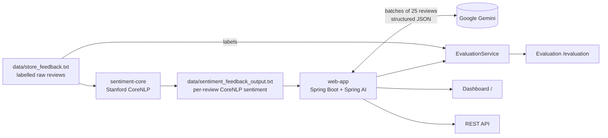

# Retail Feedback Insights

AI-powered customer feedback analytics for retail stores, built with **Java 17, Spring Boot 3.5, Spring AI, Google Gemini and Stanford CoreNLP**.

Raw customer reviews go in; out come a sentiment label, a problem category and a concrete action item for each review, a dashboard with sentiment, category and department breakdowns, and an evaluation page that measures how accurate each sentiment model is.

> Started as the final project of IBM's *Generative AI for Java and Spring Development* course and is being extended as a portfolio project. See [Origin and attribution](#origin-and-attribution).


## Results on the sample dataset (50 labelled reviews)

| | Course version | This version |
|---|---|---|
| Sentiment accuracy vs. dataset labels | 46% (Stanford CoreNLP, 23 / 50) | **92% (Gemini, 46 / 50)** |
| Negative reviews detected | 1 of 15 (14 labelled Neutral) | **15 of 15** |
| Reviews categorized | 46 / 50 (timeouts, unparseable answers) | **50 / 50** |
| Gemini requests for 50 reviews | 50 | **2** |
| Time to enrich 50 reviews (free tier) | ~15 minutes | **~41 seconds** |

CoreNLP stays in the pipeline as an offline baseline; the evaluation page shows both models side by side with confusion matrices and every review where a model disagrees with the label.

## How it works



| Module | What it does |
|---|---|
| `sentiment-core` | Parses the feedback file, runs CoreNLP (`tokenize, ssplit, pos, lemma, parse, sentiment`) on every sentence, keeps the most common sentence sentiment per review, and writes summary statistics, a per-department breakdown and per-review results. |
| `web-app` | Reads that output and sends the reviews to Gemini through a Spring AI `ChatClient`, 25 per request. Gemini returns typed JSON (`id`, `sentiment`, `category`, `actionableInsight`) that Spring AI maps straight into Java records. Results are cached and served through a Thymeleaf + Chart.js dashboard, an evaluation page and a JSON API. |

## Getting started

Requirements: JDK 17+, Maven 3.9+, and a free Gemini API key from [Google AI Studio](https://aistudio.google.com/apikey).

```bash
# 1. Build and test both modules (tests mock Gemini, no key needed)
mvn clean package

# 2. (Optional) Re-run sentiment analysis; the repo already ships data/sentiment_feedback_output.txt
mvn -pl sentiment-core exec:java

# 3. Start the web app with your key (never commit it)
export GEMINI_API_KEY=your-key            # PowerShell: $env:GEMINI_API_KEY="your-key"
java -jar web-app/target/web-app-0.1.0-SNAPSHOT.jar
```

Open <http://localhost:8080> for the dashboard and <http://localhost:8080/evaluation> for the model comparison. The first page load analyses all reviews (about 40 seconds on the free tier); results are cached afterwards.

The first build downloads the CoreNLP models (~470 MB).

### Configuration

| Environment variable | Default | Purpose |
|---|---|---|
| `GEMINI_API_KEY` | – | Gemini API key (required for AI results) |
| `GEMINI_MODEL` | `gemini-flash-lite-latest` | Gemini model to call |
| `FEEDBACK_AI_BATCH_SIZE` | `25` | Reviews per Gemini request |
| `FEEDBACK_INPUT_FILE` | `data/sentiment_feedback_output.txt` | CoreNLP output to read |
| `FEEDBACK_LABELS_FILE` | `data/store_feedback.txt` | Labelled dataset used for evaluation |
| `PORT` | `8080` | HTTP port |

See [.env.example](.env.example).

## Pages and API

| Method | Path | Returns |
|---|---|---|
| `GET` | `/` | Dashboard (HTML) |
| `GET` | `/evaluation` | Sentiment accuracy, confusion matrices and disagreements (HTML) |
| `GET` | `/getfeedback` | All reviews with CoreNLP `sentiment`, Gemini `aiSentiment`, `category` and `actionableInsight` (JSON) |
| `GET` | `/api/evaluation` | The evaluation report (JSON) |

Example review from `/getfeedback`:

```json
{
  "id": 2,
  "customer": "Michael Johnson, Loyalty Member",
  "department": "Customer Service",
  "date": "2025-05-10",
  "comment": "Staff seemed uninterested in helping me. The music playing in the store was too loud.",
  "sentiment": "NEUTRAL",
  "aiSentiment": "NEGATIVE",
  "category": "Store Experience",
  "actionableInsight": "Lower in-store background music volume and conduct customer service retraining for staff."
}
```

## Engineering notes

- **Batching instead of one call per review.** The course version made 50 sequential HTTP calls; with a free-tier key that took ~15 minutes and some calls timed out. Sending 25 reviews per request cut it to 2 calls and ~41 seconds.
- **Structured output instead of regex.** `ChatClient.call().entity(new ParameterizedTypeReference<List<AiReview>>() {})` adds a JSON schema to the prompt and maps the answer to records, and the request asks Gemini for `application/json`. Categories outside the fixed list are mapped to `Other`, because the model occasionally invents one.
- **Failures degrade, not crash.** If a batch fails (quota, network), its reviews are marked `Uncategorized` with the reason, and the rest of the dashboard still works.
- **Evaluation against ground truth.** The raw dataset carries a label per review (`Feedback #12 [NEGATIVE]`). `EvaluationService` collapses CoreNLP's five classes to three and reports accuracy and a confusion matrix per model.
- **Configurable model.** The course code targeted `gemini-1.5-flash`, which Google retired, and `gemini-2.5-flash` was unavailable to new keys, so the model is a property.
- **Secrets.** The API key comes only from the environment; tests start the Spring context with a dummy key and a mocked analyzer, so CI never needs a real key.
- **Consistent output.** Numbers are formatted with `Locale.US` and files are read/written as UTF-8, so results are the same on any machine locale.

## Tests

`mvn test` runs without network access:

- `FeedbackServiceTest`: parses the real sample file, checks batching (50 reviews → 2 calls), caching, category fallback and that a failed batch degrades to `Uncategorized`, all with a mocked Gemini analyzer.
- `EvaluationServiceTest`: label parsing, five-to-three class mapping, accuracy and confusion matrix.
- `FeedbackServiceApplicationTests`: the Spring context starts.

## Roadmap

- [x] **Phase 0:** single repository, configurable paths and model, secrets via environment
- [x] **Phase 1:** Spring AI `ChatClient` with structured JSON output, batched prompts (15 min → 41 s), evaluation page comparing CoreNLP vs Gemini against the labels (46% → 92%)
- [ ] **Phase 2:** CSV upload, PostgreSQL persistence, async processing with progress, filters, trends, per-department executive summary, Indonesian-language reviews
- [ ] **Phase 3:** OpenAPI docs, Spring AI evaluators for insight quality, Docker Compose, GitHub Actions, live demo
- [ ] **Phase 4:** "ask your feedback" chat (RAG), alerts on negative spikes

## Origin and attribution

The starting point was the final project of IBM Skills Network's *Generative AI for Java and Spring Development* course (starter repository [`ibm-developer-skills-network/cbnjx-feedback-service`](https://github.com/ibm-developer-skills-network/cbnjx-feedback-service), Apache License 2.0). The sample dataset and the initial versions of the sentiment analyzer, services and dashboard come from that course. Restructuring, fixes and further features in this repository are my own work.

Licensed under the [Apache License 2.0](LICENSE).
