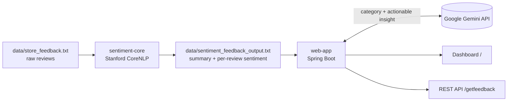

# Retail Feedback Insights

AI-powered customer feedback analytics for retail stores, built with **Java 17, Stanford CoreNLP, Spring Boot 3 and Google Gemini**.

Raw customer reviews go in; out come sentiment labels, a problem category, and a concrete action item for each review, plus a dashboard with sentiment, category and department breakdowns.

> Started as the final project of IBM's *Generative AI for Java and Spring Development* course and is being extended as a portfolio project. See [Origin and attribution](#origin-and-attribution).

## How it works



| Module | What it does |
|---|---|
| `sentiment-core` | Parses the feedback file, runs CoreNLP (`tokenize, ssplit, pos, lemma, parse, sentiment`) on every sentence, keeps the most common sentence sentiment per review, and writes summary statistics, a per-department breakdown and per-review results. |
| `web-app` | Reads that output, asks Gemini to categorize each review (Product Quality, Customer Service, Store Experience, Website/App, Delivery, Price/Value, Inventory/Stock, Other) and suggest an action, caches the result, and serves a Thymeleaf + Chart.js dashboard and a JSON API. |

## Results on the sample dataset (50 labelled reviews)

| Metric | Value |
|---|---|
| CoreNLP sentiment vs. dataset labels | **23 / 50 correct (46%)** |
| Negative reviews CoreNLP labelled as Neutral | **14 of 15** |
| Reviews categorized by Gemini | 46 / 50 (3 timeouts, 1 unparseable answer) |
| Time to enrich 50 reviews (one Gemini call each, free tier) | ~15 minutes |

These numbers are the baseline the [roadmap](#roadmap) sets out to improve: CoreNLP's sentence-level model misses retail-specific complaints, and one API call per review is slow.

## Getting started

Requirements: JDK 17+, Maven 3.9+, and a free Gemini API key from [Google AI Studio](https://aistudio.google.com/apikey).

```bash
# 1. Build both modules
mvn clean package -DskipTests

# 2. (Optional) Re-run sentiment analysis; the repo already ships data/sentiment_feedback_output.txt
mvn -pl sentiment-core exec:java

# 3. Start the web app with your key (never commit it)
export GEMINI_API_KEY=your-key            # PowerShell: $env:GEMINI_API_KEY="your-key"
java -jar web-app/target/web-app-0.1.0-SNAPSHOT.jar
```

Open <http://localhost:8080>. The first load calls Gemini once per review, so it takes a few minutes on the free tier; results are cached afterwards.

The first `mvn package` downloads the CoreNLP models (~470 MB).

### Configuration

| Environment variable | Default | Purpose |
|---|---|---|
| `GEMINI_API_KEY` | – | Gemini API key (required for categories and insights) |
| `GEMINI_MODEL` | `gemini-flash-lite-latest` | Gemini model to call |
| `FEEDBACK_INPUT_FILE` | `data/sentiment_feedback_output.txt` | Sentiment analysis output to read |
| `PORT` | `8080` | HTTP port |

See [.env.example](.env.example).

## API

| Method | Path | Returns |
|---|---|---|
| `GET` | `/` | Dashboard (HTML) |
| `GET` | `/getfeedback` | All reviews with `sentiment`, `category` and `actionableInsight` (JSON) |

Example item:

```json
{
  "id": 2,
  "customer": "Michael Johnson, Loyalty Member",
  "department": "Customer Service",
  "date": "2025-05-10",
  "comment": "Staff seemed uninterested in helping me. The music playing in the store was too loud.",
  "sentiment": "NEUTRAL",
  "category": "Customer Service",
  "actionableInsight": "Conduct staff retraining on customer engagement and establish clear guidelines for in-store music volume..."
}
```

## Engineering notes

- **Model is configurable.** The course code targeted `gemini-1.5-flash`, which Google retired; `gemini-2.5-flash` was also unavailable to new keys. The model is now a property instead of a hard-coded URL.
- **API key handling.** The key comes only from the environment and is sent in the `x-goog-api-key` header rather than the URL, so it does not appear in logs.
- **Resilience.** HTTP timeouts (10 s connect / 30 s read) and retries on HTTP 429 stop a single slow call from blocking the whole dashboard.
- **Consistent output.** Numbers are formatted with `Locale.US` and files are read/written as UTF-8, so results are the same on any machine locale.

## Roadmap

- [x] **Phase 0:** single repository, configurable paths and model, secrets via environment
- [ ] **Phase 1:** Spring AI `ChatClient` with structured JSON output, batched prompts (target < 1 min for 50 reviews), evaluation page comparing CoreNLP vs Gemini against the labels
- [ ] **Phase 2:** CSV upload, PostgreSQL persistence, async processing with progress, filters, trends, per-department executive summary, Indonesian-language reviews
- [ ] **Phase 3:** tests with a mocked Gemini and Spring AI evaluators, OpenAPI docs, Docker Compose, GitHub Actions, live demo
- [ ] **Phase 4:** "ask your feedback" chat (RAG), alerts on negative spikes

## Origin and attribution

The starting point was the final project of IBM Skills Network's *Generative AI for Java and Spring Development* course (starter repository [`ibm-developer-skills-network/cbnjx-feedback-service`](https://github.com/ibm-developer-skills-network/cbnjx-feedback-service), Apache License 2.0). The sample dataset and the initial versions of the sentiment analyzer, services and dashboard come from that course. Restructuring, fixes and further features in this repository are my own work.

Licensed under the [Apache License 2.0](LICENSE).
