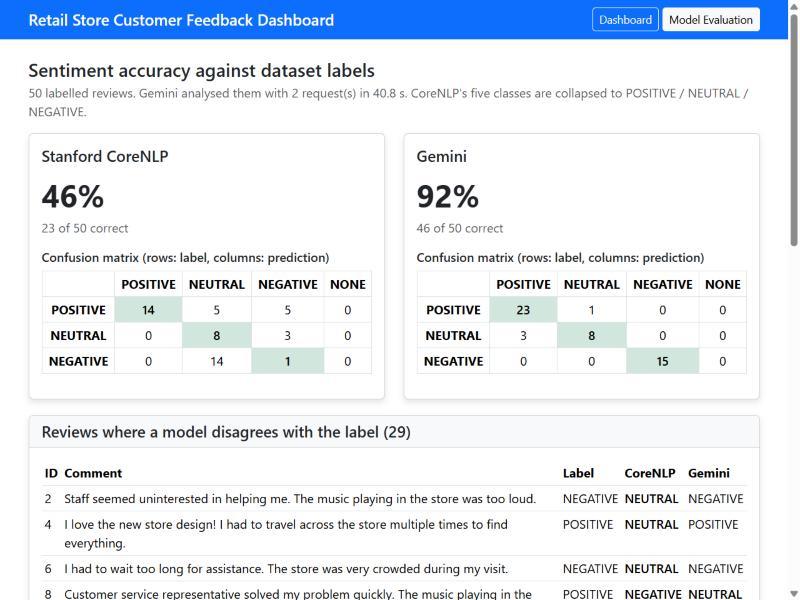
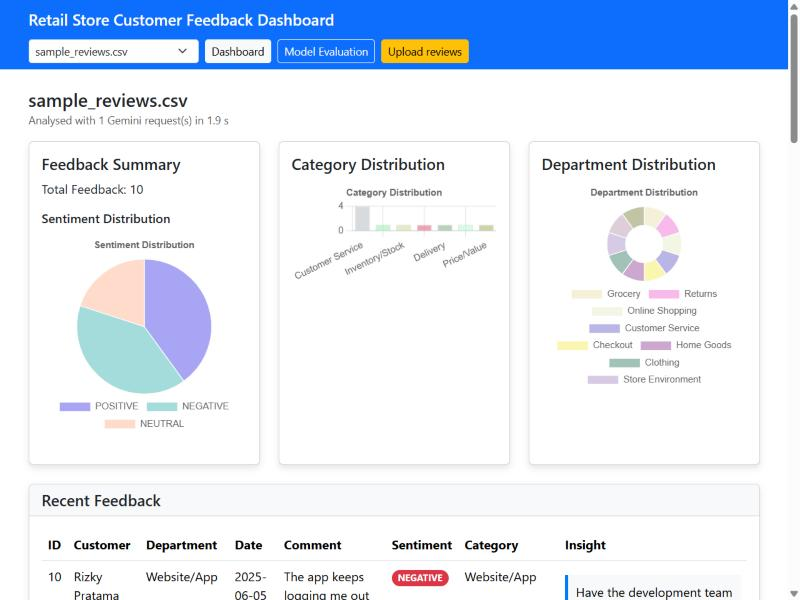
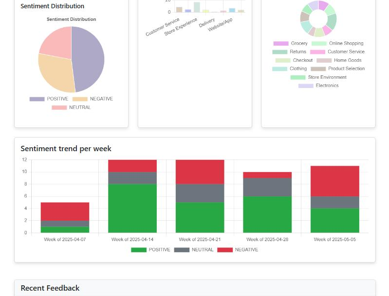
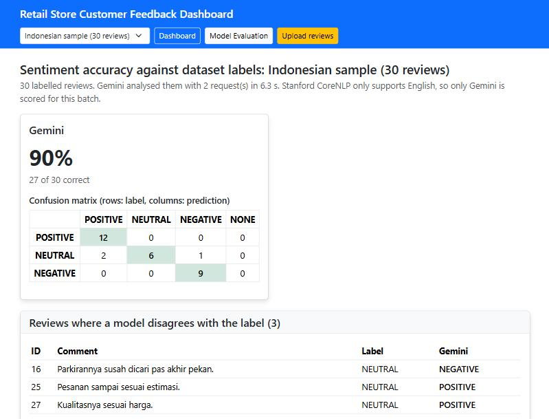
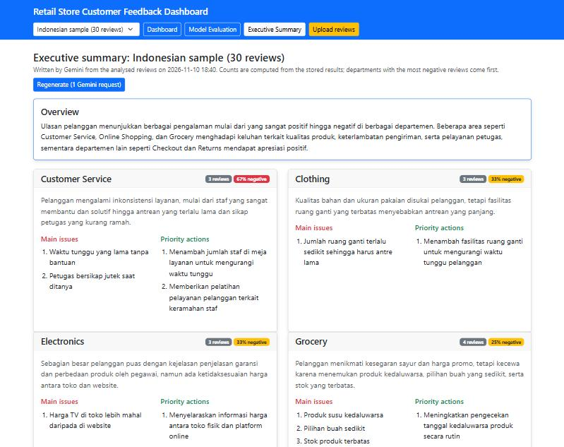
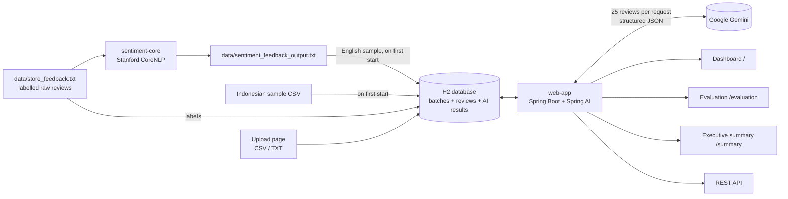

# Retail Feedback Insights

AI-powered customer feedback analytics for retail stores, built with **Java 17, Spring Boot 3.5, Spring AI, Google Gemini and Stanford CoreNLP**.

Upload customer reviews as CSV or text, in **English or Indonesian** (including informal Indonesian); each review gets a sentiment label, a problem category and a concrete action item written in the review's language. Results are stored in a database and shown on a filterable dashboard with sentiment, category and department breakdowns and a weekly sentiment trend, an executive summary with the main issues and priority actions per department, and an evaluation page that measures how accurate each sentiment model is.

> Started as the final project of IBM's *Generative AI for Java and Spring Development* course and is being extended as a portfolio project. See [Origin and attribution](#origin-and-attribution).



## Results on the sample dataset (50 labelled reviews)

| | Course version | This version |
|---|---|---|
| Sentiment accuracy vs. dataset labels | 46% (Stanford CoreNLP, 23 / 50) | **92% (Gemini, 46 / 50)** |
| Negative reviews detected | 1 of 15 (14 labelled Neutral) | **15 of 15** |
| Reviews categorized | 46 / 50 (timeouts, unparseable answers) | **50 / 50** |
| Gemini requests for 50 reviews | 50 | **2** |
| Time to enrich 50 reviews (free tier) | ~15 minutes | **~10-41 seconds** (varies with Gemini latency) |
| Reviews you can analyse | The bundled file only | **Any CSV/TXT upload**, stored in a database |
| Languages | English only (CoreNLP) | **English and Indonesian**: 27 / 30 (90%) on the Indonesian sample |

CoreNLP stays in the pipeline as an offline baseline; the evaluation page shows both models side by side with confusion matrices and every review where a model disagrees with the label.



Filter by department, sentiment, category and date range; the charts, the weekly trend and the review table all follow the filter.



### Indonesian reviews

The app ships a second, labelled sample of 30 Indonesian reviews written the way customers actually write, with slang such as *gak*, *banget*, *mantap*, *kekencengan* and *jutek*. Stanford CoreNLP has no Indonesian sentiment model, so only Gemini is scored; it gets every positive (12/12) and negative (9/9) review right, and the 3 misses are borderline neutral reviews such as *"Kualitasnya sesuai harga"*. Insights come back in Indonesian, for example *"Tingkatkan pengecekan tanggal kedaluwarsa produk secara berkala sebelum dijual."*



### Executive summary per department

For managers who won't read 50 reviews, the *Executive Summary* page asks Gemini, in **one request per batch**, for an overview plus up to three main issues and three priority actions for every department, written in the language of the reviews. The result is stored, so opening the page again costs nothing; next to Gemini's text the page shows the measured review count and negative share, and departments are ordered by negative reviews. Generating took about 7-8 seconds for the 50-review English and the 30-review Indonesian sample.



## How it works



| Module | What it does |
|---|---|
| `sentiment-core` | Parses the feedback file, runs CoreNLP (`tokenize, ssplit, pos, lemma, parse, sentiment`) on every sentence, keeps the most common sentence sentiment per review, and writes summary statistics, a per-department breakdown and per-review results. |
| `web-app` | Stores reviews in batches (the bundled English and Indonesian samples or an uploaded file) and sends them to Gemini through a Spring AI `ChatClient`, 25 per request. Gemini returns typed JSON (`id`, `language`, `sentiment`, `category`, `actionableInsight`) that Spring AI maps straight into Java records. Results are saved, so each batch is analysed only once, and served through a Thymeleaf + Chart.js dashboard, an evaluation page and a JSON API. |

## Getting started

Requirements: JDK 17+, Maven 3.9+, and a free Gemini API key from [Google AI Studio](https://aistudio.google.com/apikey).

```bash
# 1. Build and test both modules (tests mock Gemini, no key needed)
mvn clean package

# 2. (Optional) Re-run sentiment analysis; the repo already ships data/sentiment_feedback_output.txt
mvn -pl sentiment-core exec:java

# 3. Start the web app with your key (never commit it)
export GEMINI_API_KEY=your-key            # PowerShell: $env:GEMINI_API_KEY="your-key"
java -jar web-app/target/web-app-0.1.0-SNAPSHOT.jar
```

Open <http://localhost:8080> for the dashboard, <http://localhost:8080/evaluation> for the model comparison and <http://localhost:8080/upload> to analyse your own reviews (sample CSVs: [English](web-app/src/main/resources/static/samples/sample_reviews.csv), [Indonesian](web-app/src/main/resources/static/samples/sample_reviews_id.csv)). Gemini starts analysing a batch right after the upload (or the first time a sample is opened) in a background worker; the page shows a live progress bar and opens the results when it is done. Results are stored in `data/db/`, so later visits and restarts don't call the API again.

### Upload format

CSV with a header row; only `comment` is required, and a `label` column (POSITIVE / NEUTRAL / NEGATIVE) enables the accuracy evaluation:

```csv
id,customer,department,date,comment,label
1,Jane Smith,Checkout,2025-05-01,"Fast checkout, friendly cashier.",POSITIVE
```

Text files use the dataset's block format (`Feedback #1 [POSITIVE]`, then `Customer:`, `Department:`, `Date:`, `Comment:` lines). Uploads are limited to 200 reviews and 1 MB, because every review costs Gemini quota.

The first build downloads the CoreNLP models (~470 MB).

### Configuration

| Environment variable | Default | Purpose |
|---|---|---|
| `GEMINI_API_KEY` | – | Gemini API key (required for AI results) |
| `GEMINI_MODEL` | `gemini-flash-lite-latest` | Gemini model to call |
| `FEEDBACK_AI_BATCH_SIZE` | `25` | Reviews per Gemini request |
| `FEEDBACK_INPUT_FILE` | `data/sentiment_feedback_output.txt` | CoreNLP output to read |
| `FEEDBACK_LABELS_FILE` | `data/store_feedback.txt` | Labels for the sample dataset |
| `FEEDBACK_UPLOAD_MAX_REVIEWS` | `200` | Maximum reviews per upload |
| `DATABASE_URL` | `jdbc:h2:file:./data/db/feedback` | JDBC URL of the database |
| `PORT` | `8080` | HTTP port |

See [.env.example](.env.example).

## Pages and API

| Method | Path | Returns |
|---|---|---|
| `GET` | `/?batch={id}&department=&sentiment=&category=&from=&to=` | Dashboard (HTML); filters are optional, dates are `YYYY-MM-DD` |
| `GET` | `/evaluation?batch={id}` | Sentiment accuracy, confusion matrices and disagreements (HTML) |
| `GET` | `/summary?batch={id}` | Executive summary per department (HTML); shows a generate button until one exists |
| `POST` | `/batches/{id}/summary` | Generate or regenerate the executive summary (one Gemini request) |
| `GET` | `/api/batches/{id}/summary` | The stored summary: `overview` and `departments[]` with `summary`, `topIssues`, `priorityActions` (JSON); `404` if none was generated, never calls Gemini |
| `GET`, `POST` | `/upload` | Upload form / upload a CSV or TXT file |
| `POST` | `/batches/{id}/reanalyze` | Retry Gemini, in the background, for reviews without a result |
| `GET` | `/api/batches/{id}/status` | Analysis progress: `analyzed`, `running`, `processedReviews`, `reviewCount`, `failedReviews` (JSON) |
| `GET` | `/getfeedback?batch={id}` | Reviews with CoreNLP `sentiment`, Gemini `aiSentiment`, `category` and `actionableInsight` (JSON); accepts the same filters as the dashboard |
| `GET` | `/api/evaluation?batch={id}` | The evaluation report (JSON) |
| `GET` | `/api/batches` | All batches with review counts and analysis status (JSON) |

`batch` is optional everywhere and defaults to the most recent batch. The HTML pages show a progress page while a batch is being analysed; the JSON endpoints wait for the analysis to finish instead.

Example review from `/getfeedback`:

```json
{
  "id": 2,
  "customer": "Michael Johnson, Loyalty Member",
  "department": "Customer Service",
  "date": "2025-05-10",
  "comment": "Staff seemed uninterested in helping me. The music playing in the store was too loud.",
  "sentiment": "NEUTRAL",
  "aiSentiment": "NEGATIVE",
  "category": "Store Experience",
  "actionableInsight": "Lower in-store background music volume and conduct customer service retraining for staff."
}
```

## Engineering notes

- **Batching instead of one call per review.** The course version made 50 sequential HTTP calls; with a free-tier key that took ~15 minutes and some calls timed out. Sending 25 reviews per request cut it to 2 calls and ~41 seconds.
- **Structured output instead of regex.** `ChatClient.call().entity(new ParameterizedTypeReference<List<AiReview>>() {})` adds a JSON schema to the prompt and maps the answer to records, and the request asks Gemini for `application/json`. Categories outside the fixed list are mapped to `Other`, because the model occasionally invents one.
- **Multilingual by prompt, fixed categories.** The system prompt tells Gemini that reviews may be English or informal Indonesian, to report the language (ISO 639-1), to keep categories in English so charts stay comparable, and to write the insight in the review's language. The evaluation page drops CoreNLP for batches it can't analyse.
- **Background analysis with progress.** Uploads return immediately; a single-thread worker sends the reviews to Gemini (one batch at a time, which also respects free-tier rate limits) and saves progress after every request. The progress page polls `/api/batches/{id}/status` and reloads when the batch is done. Repeated page loads don't queue the same batch twice, and an "analyzing" flag left behind by a crash is cleared on startup.
- **Filters and trend from stored data.** Filtering and the weekly trend are computed from the stored results, so they cost no API calls. Sentiment filters and charts use Gemini's label, falling back to CoreNLP; the trend groups reviews by ISO week (Monday start) and fills empty weeks with zeros so the time axis is continuous; reviews without a valid date are left out of date filters and the trend.
- **Executive summary on demand.** The summary is a second structured-output call (`.entity(ExecutiveSummary.class)`) with its own system prompt, fed with the already analysed reviews (department, sentiment, category, comment cut to 300 characters) so it costs one request even for a 200-review upload. It is only generated when someone presses the button, stored as JSON with the batch, and its review counts come from the database rather than from the model, so the numbers on the page can't be hallucinated.
- **Analyse once, store the result.** Batches and Gemini results live in a database (H2 file by default, any JDBC URL via `DATABASE_URL`), so a batch costs API quota only the first time it is opened, also across restarts.
- **Failures degrade, not crash.** If a request fails (quota, network), its reviews are marked `Uncategorized` with the reason, the dashboard shows how many are missing, and a "Retry with Gemini" button re-sends only those reviews.
- **Upload validation.** The parser accepts CSV (any column order, optional columns, quoted commas, UTF-8 BOM) and the dataset's text format, and rejects files without comments, bad ids or more than 200 reviews with a message on the page.
- **Evaluation against ground truth.** The raw dataset carries a label per review (`Feedback #12 [NEGATIVE]`). `EvaluationService` collapses CoreNLP's five classes to three and reports accuracy and a confusion matrix per model.
- **Configurable model.** The course code targeted `gemini-1.5-flash`, which Google retired, and `gemini-2.5-flash` was unavailable to new keys, so the model is a property.
- **Secrets.** The API key comes only from the environment; tests start the Spring context with a dummy key and a mocked analyzer, so CI never needs a real key.
- **Consistent output.** Numbers are formatted with `Locale.US` and files are read/written as UTF-8, so results are the same on any machine locale.

## Tests

`mvn test` runs 34 tests without network access (Gemini is mocked, the database is in-memory):

- `FeedbackFlowIntegrationTest`: both samples are imported once on startup (English is the default); the Indonesian batch keeps the detected language and is scored with Gemini only; a batch is analysed in 2 calls and later reads use the database; failed requests are counted and can be retried; evaluation scores both models; a CSV upload becomes a new batch and is analysed in the background; an unanalysed batch shows the progress page and the status endpoint reports completion; retries run in the background; a stale "analyzing" flag is cleared on startup; dashboard and API filters return the right subset; the executive summary is generated only on request, once, and served from the database afterwards, and a failed request shows an error and stores nothing; invalid uploads store nothing; unknown batches return 404.
- `FeedbackFileParserTest`: CSV variants, the raw text dataset, the CoreNLP output format and invalid files.
- `EvaluationServiceTest`: five-to-three class mapping, accuracy and confusion matrix.
- `FeedbackSummaryTest`: filter matching (department, displayed sentiment, category, inclusive date range, blank values) and the weekly trend (Monday grouping, empty weeks, undated reviews).
- `GeminiFeedbackAnalyzerTest`: the prompt covers Indonesian reviews, the language field and every category; the summary prompt asks for up to three issues and actions per department; summary input uses the displayed sentiment and shortens long comments; summary sections follow the measured negative counts.
- `FeedbackServiceApplicationTests`: the Spring context starts.

## Roadmap

- [x] **Phase 0:** single repository, configurable paths and model, secrets via environment
- [x] **Phase 1:** Spring AI `ChatClient` with structured JSON output, batched prompts (15 min → 41 s), evaluation page comparing CoreNLP vs Gemini against the labels (46% → 92%)
- [x] **Phase 2A:** CSV/TXT upload with validation, batches and AI results stored in a database, batch selector, retry for failed reviews
- [x] **Phase 2C:** Indonesian reviews (labelled 30-review sample, language detection, insights in the review's language): Gemini 90%
- [x] **Phase 2B:** background analysis with a live progress page and status endpoint
- [x] **Phase 2D:** dashboard filters (department, sentiment, category, date range) and a weekly sentiment trend
- [x] **Phase 2E:** per-department executive summary (main issues + priority actions), one Gemini request per batch
- [ ] **Phase 3:** OpenAPI docs, Spring AI evaluators for insight quality, Docker Compose, GitHub Actions, live demo
- [ ] **Phase 4:** "ask your feedback" chat (RAG), alerts on negative spikes

## Origin and attribution

The starting point was the final project of IBM Skills Network's *Generative AI for Java and Spring Development* course (starter repository [`ibm-developer-skills-network/cbnjx-feedback-service`](https://github.com/ibm-developer-skills-network/cbnjx-feedback-service), Apache License 2.0). The sample dataset and the initial versions of the sentiment analyzer, services and dashboard come from that course. Restructuring, fixes and further features in this repository are my own work.

Licensed under the [Apache License 2.0](LICENSE).
